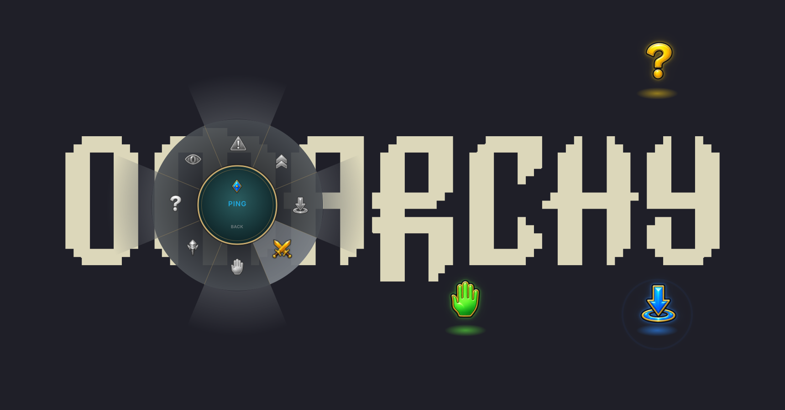

# Ping Wheel

A MOBA-style ping wheel for the whole [Omarchy](https://omarchy.org/) desktop. Hold **Alt**, drag, let go on a ping: an animated marker pops where you pressed, with a sound, on top of any app.



An Omarchy shell plugin (a `service` that runs inside `omarchy-shell`), inspired by [darrenprx/lolPing](https://github.com/darrenprx/lolPing), whose Linux build is X11-only. The wheel geometry and animation timings are ported from it; the icons and sounds are this project's own (see [Assets](#assets)).

## Install

```sh
omarchy plugin add https://github.com/Unayung/omarchy-lol-ping --enable
```

Then add the trigger to `~/.config/hypr/bindings.lua` (the plugin never edits your config itself):

```lua
o.bind("ALT + mouse:272", "Ping wheel", hl.dsp.global("pingwheel:wheel"))
```

Hyprland reloads the file on save. Needs `pw-play` (PipeWire), which Omarchy ships.

`--enable` also puts the plugin's icon (󰓾) on the right of the bar: click it for the settings panel (rooms, volume, ping size and duration, asset pack), right-click to pause and resume. In a room it shows how many friends are there. To bind the panel to a key as well:

```lua
o.bind("SUPER + ALT + P", "Ping Wheel settings", "omarchy-shell shell toggle io.github.unayung.ping-wheel")
```

To update: `omarchy plugin update io.github.unayung.ping-wheel`, then `omarchy restart shell` (the shell keeps the old QML cached until it restarts).

Coming from 1.0 (no bar icon yet)? 1.0 was enabled through a `plugins[]` entry in `shell.json`, which stops `omarchy bar put` from placing the icon. Swap it for a bar entry once:

```sh
omarchy plugin disable io.github.unayung.ping-wheel
omarchy bar put io.github.unayung.ping-wheel --section right
```

## Use

| To | Do this |
| --- | --- |
| Ping | Hold **Alt + left mouse**, drag, let go on a slice |
| Cancel | Let go in the centre, right-click, or press **Esc** |
| Pause or resume | Right-click the bar icon (no wheel and no friends' pings while paused) |

The wheel, from the top going clockwise: Danger, Push, On My Way, All In, Assist Me, Need Vision, Enemy Missing, Enemy Vision.

Ping size, duration and volume are in the settings panel (saved to `~/.local/state/ping-wheel/settings.json`).

While the bind is active, Alt + left click no longer reaches apps: Wayland gives no way to replay a click that the compositor has already taken.

## Asset packs

Two packs, switchable at any time from the settings panel or the commands below; the plugin picks up the change at once, no restart.

| Pack | What it is | Where it comes from |
| --- | --- | --- |
| `custom` (default) | This project's own icons and sounds | Bundled in `assets/` |
| `official` | The original League of Legends ping art and sounds, with All In's two-halves clash | Downloaded to your machine by `tools/fetch-official.sh`; never part of this repository |

The official files are Riot Games' property. The fetch script pulls them from [darrenprx/lolPing](https://github.com/darrenprx/lolPing) at a pinned commit, over HTTPS, only when you run it. Whether to use them is your call; Riot's [fan content policy](https://www.riotgames.com/en/legal) covers free, non-commercial fan use, so read it if that matters to you.

```sh
P=~/.config/omarchy/plugins/io.github.unayung.ping-wheel

$P/tools/fetch-official.sh     # once: download the official pack to ~/.local/share/ping-wheel/official
$P/tools/pack.sh official      # switch to it
$P/tools/pack.sh custom        # back to the bundled pack
$P/tools/pack.sh toggle        # flip between the two
$P/tools/pack.sh               # print the current pack
```

`pack.sh` writes the choice to `~/.local/state/ping-wheel/pack`, which the plugin watches. Picking `official` before downloading it is refused; if the files go missing later, the plugin falls back to `custom` and logs a warning. To switch from a key, bind the script, e.g. `o.bind("SUPER + ALT + O", "Ping wheel pack", "~/.config/omarchy/plugins/io.github.unayung.ping-wheel/tools/pack.sh toggle")`.

## Rooms

Join a [lolPing](https://github.com/darrenprx/lolPing) room and everyone in it, on Windows, Mac or here, sees your pings on their own screen at the same spot, with your name under them; theirs show up on yours. Pings only: lolPing's text, votes, emotes and room panel are not part of this plugin, and friends' emotes don't show here.

Rooms need Node.js (`omarchy pkg add nodejs`); without it everything else works as before.

Create, join and leave from the **Room** section of the settings panel, which also shows who is in the room and whether they came over the local network or the internet. The same from a terminal:

```sh
P=~/.config/omarchy/plugins/io.github.unayung.ping-wheel

$P/tools/room.sh create --name Yung          # new room; prints the code and copies it
$P/tools/room.sh join PING-7KQ4M-2HXTR       # a code a friend sent you
$P/tools/room.sh join PING-7KQ4M-2HXTR --name Yung --color 3   # tag colour 0-7
$P/tools/room.sh leave
$P/tools/room.sh                             # print the current room
```

The name defaults to your user name. A notification says when someone joins or leaves.

- **Same network:** found over UDP broadcast on port 47474, the port lolPing uses.
- **Different networks:** through the same public [Nostr](https://nostr.com) relays lolPing uses.
- A ping lands on the display with the same number (1 is the one at the top-left corner, 0,0 in Hyprland; the rest go left to right), or on display 1.
- **Privacy:** pings and names are end-to-end encrypted with a key made from the room code, the same scheme as lolPing. People on your network see your local IP address. Public relays see your IP address, an anonymous room ID and when you send, but never your pings or name.

## Remove

```sh
omarchy plugin remove io.github.unayung.ping-wheel
```

and delete the `pingwheel:wheel` line from `~/.config/hypr/bindings.lua`. If you used the official pack or rooms, also `rm -rf ~/.local/share/ping-wheel ~/.local/state/ping-wheel`.

## Without the Omarchy shell

Any Hyprland + Quickshell setup can run it on its own: `qs -p /path/to/omarchy-lol-ping`, with the same bind (`bind = ALT, mouse:272, global, pingwheel:wheel` in a classic `hyprland.conf`). The settings panel needs the Omarchy shell; use `tools/room.sh` and `tools/pack.sh` there instead.

## Assets

- Icons: generated with OpenAI `gpt-image-2.5-sunburst` from `tools/icons-prompt.txt` as one sheet (`tools/icons-sheet.png`), sliced into `assets/textures/`.
- Sounds: synthesised by `tools/gen-sounds.py` (`python3 tools/gen-sounds.py` rebuilds `assets/sounds/`).

No game art or audio is included in this repository (the optional official pack is fetched separately, see [Asset packs](#asset-packs)). Not affiliated with Riot Games or League of Legends.

## Dependencies

Omarchy (Hyprland, Quickshell `omarchy-shell`), PipeWire `pw-play`; Node.js for rooms only. Development check: `node check.mjs` (slice picking).

## License

MIT, see `LICENSE`.
